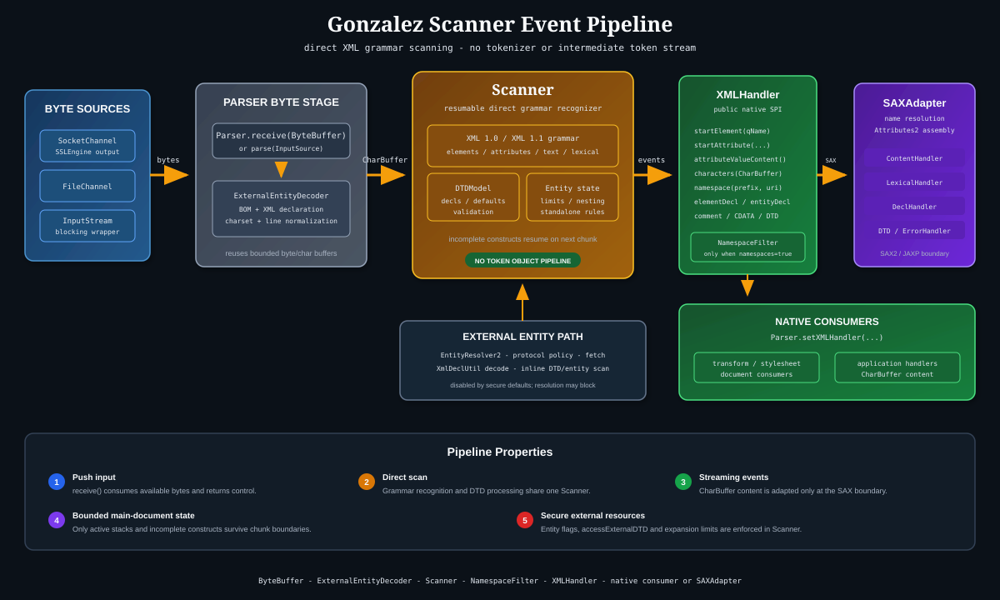

# Gonzalez

<p align="center">
  
</p>

Non-blocking streaming XML parser and serializer for event-driven I/O

This is Gonzalez, a data-driven XML parser and serializer using non-blocking,
event-driven I/O. Unlike traditional SAX parsers that pull data from an
InputSource, Gonzalez is completely feedforward: you push data to it as it
arrives, and it produces native or SAX events without ever blocking for I/O,
as long as the documents are standalone. The XMLWriter provides the inverse:
streaming XML serialization to NIO channels.

## Features

### Parser
- non-blocking: in streaming mode, will only ever block for external entities
- data-driven: a resumable Scanner processes whatever character data is
  available directly against the XML grammar
- fully streaming public `XMLHandler` SPI allows attribute values, PI data,
  comments and text of arbitrary size while operating in constant memory
- SAX-compatible: SAXAdapter exposes ContentHandler, LexicalHandler,
  DeclHandler, DTDHandler and Attributes2 events
- JAXP integration: can be used as a drop-in SAX parser via SAXParserFactory
- JPMS module: proper Java module (`org.bluezoo.gonzalez`) for Java 9+
- inline DTD support: Scanner parses internal and external subsets directly
- memory efficient: streaming architecture handles documents of any size
- Java NIO throughput: uses ByteBuffer for content I/O operations

### Serializer (XMLWriter)
- streaming `write*` API: `writeStartElement`, `writeStartAttribute`, `writeCharacters` and so on
- NIO-first: writes to `WritableByteChannel` with automatic buffering
- constant memory: text, attribute values, comments and PI data of any size
  can be written in pieces, and the buffer is sent whenever it fills
- parser pipeline: `XMLWriterHandler` connects an `XMLParser` directly to a writer
- namespace-aware: full support for prefixed and default namespaces
- DOCTYPE output: supports inline DTD declarations with standalone conversion mode
- pretty-print: optional indentation via `IndentConfig`
- empty element optimization: automatically emits `<foo/>` instead of `<foo></foo>`
- proper escaping: handles special characters in content and attributes
- configurable encoding: UTF-8 (default), ISO-8859-1, US-ASCII, or any Java charset

## Architecture

Traditional SAX parsers use a pull model where the parser controls the flow of
data via InputSource. This requires blocking I/O and makes them incompatible
with asynchronous frameworks. Gonzalez inverts this by using a push model where
data is fed to the parser via `receive(ByteBuffer)`.

The parser is a resumable state machine that processes whatever data is
available and retains only incomplete XML constructs across input boundaries.
When the end of the currently
available data chunk is reached, parsing returns control to the caller, who can feed
more data as and when it arrives. This makes Gonzalez suitable for integration with
async I/O frameworks such as Gumdrop or Netty. Crucially, parsing events are emitted as soon as they can be parsed, meaning that you can process data in your application before having received the entire document and without blocking an entire thread to do it.

### NIO Event Pipeline

The following diagram shows both the byte/character path and the event paths.
ByteBuffer chunks are decoded and normalized, Scanner recognizes XML and DTD
grammar directly, and the resulting `XMLHandler` stream is optionally
namespace-filtered (in `namespaceAware` mode). It then goes either directly to
a native consumer or through `SAXAdapter` to standard SAX2 callbacks:



### Decoder, Scanner, and event adaptation

Gonzalez treats the source document being processed itself as an external
entity, as well as external entities that are potentially referenced
inside it. ExternalEntityDecoder converts incoming document bytes into
characters. It uses the BOM and XML declaration to choose a Java charset,
normalizes XML line endings, and forwards CharBuffer chunks to Scanner.

Scanner processes those characters directly against the XML grammar. It owns
element/entity stacks, DTD declarations and validation state, and preserves
incomplete constructs when a receive boundary falls in the middle of markup.
It emits the streaming `XMLHandler` vocabulary: raw element names, streamed
attribute values and text, namespace declarations, DTD declarations and
lexical boundaries. `XMLHandler` is a public Gonzalez-specific SPI. It avoids
SAX adaptation for native consumers, but is not a standards interface and may
evolve between Gonzalez releases.

When namespace processing is enabled, `NamespaceFilter` translates `xmlns`
attributes into namespace events and can retain the original attributes when
`namespace-prefixes` is enabled. A handler given to `XMLParser`, the native
parser, consumes this stream directly. `Parser`, the SAX `XMLReader`, is a
wrapper around the same `XMLParser`: it maps SAX feature and property URIs onto
the native parser's typed settings, and on the standard SAX path installs
`SAXAdapter`, which resolves names, assembles the SAX `Attributes2` view, and
dispatches `ContentHandler`, `LexicalHandler`, `DeclHandler`, `DTDHandler` and
`ErrorHandler` callbacks. The native event stream does not construct or expose
intermediate token objects.

### DTD handling

Most XML documents in practice are standalone documents without DTDs. When a
DOCTYPE is present, the Scanner parses the internal and external subsets
inline into its DTDModel. The model supplies attribute defaults and types,
entity declarations, validation content models and ignorable-whitespace
decisions during the same stream. Declarations are exposed through standard
SAX interfaces: DTDHandler for notations and unparsed entities, DeclHandler
for element, attribute and entity declarations, and LexicalHandler for DTD,
comment and entity boundaries.

### External Entity Resolution

Gonzalez will use standard SAX2 EntityResolver and EntityResolver2 mechanisms
for resolving external entities in a blocking fashion. Therefore, if you process
XML streams with external entities (including the document type declaration),
this will inevitably affect the performance and reliability of the parsing
process. There is no solution to this: the alternative, using asynchronous
non-blocking I/O, is technically feasible but the parser still needs to block at
the point the external entity is defined until it has been able to finish
parsing it. Therefore all its content input would have to be buffered until the
parser was in a state ready to process it. Since that would easily lead to
resource exhaustion, Gonzalez design is to implement external entities as a
blocking process.

## XSLT Transformer

Gonzalez includes an XSLT 3.0 transformer that follows the same design
principles as the parser: event-driven processing with predictable resource
usage. The transformer integrates with standard JAXP APIs
(`TransformerFactory`, `Templates`, `Transformer`) and can be used as a
drop-in replacement for other XSLT processors.

Key features:
- **JAXP compliant** - Standard `TransformerFactory` interface
- **Streaming support** - Native `XMLHandler` ingest for Gonzalez-owned parses,
  with SAX retained at JAXP and foreign-parser boundaries
- **Iterative XPath parser** - Pratt algorithm with explicit stacks, no
  recursion
- **Forward-compatible** - Graceful handling of later XSLT version
  constructs

See **[XSLT.md](XSLT.md)** for detailed documentation on the transformer design,
features, test methodology, and performance characteristics.

## Documentation

| Document | Contents |
|----------|----------|
| [USAGE.md](USAGE.md) | Parsing with SAX, native and JAXP interfaces; locations; `XMLWriter` |
| [SECURE-CONFIGURATION.md](SECURE-CONFIGURATION.md) | Secure defaults, external entities, limits |
| [PERFORMANCE.md](PERFORMANCE.md) | Throughput and memory comparisons, and how to reproduce them |
| [XSLT.md](XSLT.md) | The XSLT transformer: design, features, testing |
| [CHANGELOG.md](CHANGELOG.md) | What changed in each release |
| [Javadoc](https://cpkb-bluezoo.github.io/gonzalez/doc/) | Package and class documentation |

## Usage

The native parser, `XMLParser`, is fed bytes as they arrive and reports to an
`XMLHandler`:

```java
XMLParser parser = new XMLParser();
parser.setHandler(myHandler);

ByteBuffer buffer = ByteBuffer.allocate(8192);
while (channel.read(buffer) != -1) {
    buffer.flip();
    parser.receive(buffer);
    buffer.compact();                 // keep any bytes not yet consumed
}
parser.close();
```

**[USAGE.md](USAGE.md)** covers the rest: the SAX `Parser` and its handlers,
the native `XMLHandler` in more detail, JAXP, document locations and line
numbers, and writing XML with `XMLWriter`.

## Security

Gonzalez is **secure by default**. External entity processing and external DTD
loading are disabled out of the box, protecting against XXE (XML External
Entity) attacks, SSRF, and entity expansion bombs, and the depth, name length
and attribute count of a document are limited.

**[SECURE-CONFIGURATION.md](SECURE-CONFIGURATION.md)** lists the defaults, how
to enable external entities and which protocols to allow, JAXP secure
processing, the XSLT transformer's settings, and the structural limits.
To report a vulnerability, see [SECURITY.md](SECURITY.md).

## Building

Use ant to build the project:

```bash
ant dist
```

This produces three jar files in the `dist` directory:

| JAR | Contents | Dependencies |
|-----|----------|--------------|
| `gonzalez-core-1.3.0.jar` | Scanner-based parser and XMLWriter | None |
| `gonzalez-xslt-1.3.0.jar` | XSLT transformer, schema (~1.7 MB) | gonzalez-core, jsonparser |
| `gonzalez-1.3.0.jar` | Combined (fat jar) (~1.9 MB) | jsonparser |

**When to use which:**
- **Core only** — Use `gonzalez-core` if you only need XML parsing/serialization (e.g. Gumdrop, Netty pipelines). Zero external dependencies.
- **XSLT** — Use `gonzalez-xslt` (plus `gonzalez-core` and jsonparser) for XSLT transformation.
- **Fat jar** — Use `gonzalez-1.3.0.jar` for backward compatibility or when you want everything in one artifact.

**Download from GitHub Releases:**
- [gonzalez-core-1.3.0.jar](https://github.com/cpkb-bluezoo/gonzalez/releases/download/v1.3.0/gonzalez-core-1.3.0.jar)
- [gonzalez-xslt-1.3.0.jar](https://github.com/cpkb-bluezoo/gonzalez/releases/download/v1.3.0/gonzalez-xslt-1.3.0.jar)
- [gonzalez-1.3.0.jar](https://github.com/cpkb-bluezoo/gonzalez/releases/download/v1.3.0/gonzalez-1.3.0.jar)

The build downloads the jsonparser library automatically (see Dependencies below).

## Implementation Status

Gonzalez supports the entire XML specification:
- XML declaration with all charsets supported by Java
- DOCTYPE with internal and external subsets
- Elements with attributes
- Character data and CDATA sections
- Entity references (character, internal, external)
- Processing instructions
- Comments
- XML Namespaces
- Validation using DTD
- XML 1.1

## Performance

Gonzalez was compared with the SAX parser bundled with JDK 25 (Xerces) and
[aalto-xml](https://github.com/FasterXML/aalto-xml) 1.4.0. Through the SAX
interface it is faster than Xerces on most documents, and Aalto is between
about 1.1 and 1.7 times as fast as Gonzalez SAX. The native `XMLHandler` path
is faster than Gonzalez SAX on every corpus, and the difference is what the
SAX layer costs.

For documents of a few kilobytes, what matters is the cost of setting up a
parser: one that is kept and `reset()` between documents is within about 1.2
to 1.8 times the time Aalto takes, and one made for each document is slower.

That layer is also what lets the parser report every construct in pieces. In a
32 MB heap, the native path parses a document with a single 256 MB text node,
CDATA section, attribute value or comment; the other parsers compared manage
fewer of these, and none manages all four.

**[PERFORMANCE.md](PERFORMANCE.md)** has the throughput tables for eight
corpora, the memory comparison, the figures for small documents, and how to
reproduce them.

## Conformance

Gonzalez has been tested with the W3C Conformance test suite xmlconf and
achieves 100% conformance with that suite. The test data in `xmlconf/` is from
the [20130923 release](https://www.w3.org/XML/Test/), the latest and final
official release.

## Dependencies

- Java 8 or later (including SAX API)
- **gonzalez-core** — Zero external dependencies.
- **gonzalez-xslt** — Requires `gonzalez-core` and [**jsonparser**](https://github.com/cpkb-bluezoo/jsonparser) (org.bluezoo.json). The jsonparser
  library is used for XML-to-JSON and JSON-to-XML translation (`xml-to-json`, `json-to-xml`,
  `parse-json`). The build downloads the jsonparser jar from [GitHub Releases](https://github.com/cpkb-bluezoo/jsonparser/releases)
  via the `resolve-deps` target.

For Java 9+, Gonzalez provides JPMS modules:

```java
// Parser/writer only (zero dependencies)
module myapp {
    requires org.bluezoo.gonzalez;
}

// XSLT support (requires core + jsonparser)
module myapp {
    requires org.bluezoo.gonzalez;
    requires org.bluezoo.gonzalez.xslt;
    requires org.bluezoo.json;
}
```

## License

Gonzalez is licensed under the GNU Lesser General Public License version 3.
See `COPYING` for full terms.


-- Chris Burdess

